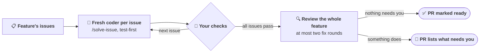

<div align="center">

# Coding Crew

### Describe a feature. Go to lunch. Come back to a reviewed PR.

**One standard set of [Agent Skills](https://agentskills.io) that turns the coding agent you already use into a dev
team: a planner, a coder per issue, and a reviewer.**

[](LICENSE)


</div>

---

A coding agent pairs with you one prompt at a time. Coding Crew works more like a team: you agree the
plan together, then it builds the feature **test-first, one issue at a time, each by a fresh coder**.
It lands only what passes your checks, reviews the whole feature, fixes what the review found, and you
get one PR at the end. Use as much of it as you like, from one skill by hand to whole features unattended.

## Get going

From inside your repo:

```bash
npx skills add ypxing/coding-crew --all      # this project (commit skills-lock.json); add -g for every repo
```

Needs git, jq and Node; `gh` too for GitHub Issues or Actions.

Installing only some skills (`-s <name>`)? Add `-s coding-crew-lib` too: every skill runs its scripts from it.
To update, re-run the same command. The [install guide](docs/guide.md#install) covers `bootstrap.sh`, a pinned
install from a clone, and what lands where.

Then, inside your coding agent:

```bash
/setup-coding-crew                                # once per repo: tracker + your dev commands
/crew-grill add rate limiting to the public API   # 👤 plan it together → issues under a feature slug
/crew-afk rate-limit                              # 🤖 the crew builds it in its own worktree while you're away
/crew-afk status                                  # which PRs are ready for you
```

That's the whole loop. You get a branch and one PR, marked ready or listing what needs you; nothing is merged
for you, and the agent runs on your own model and billing.

Any agent that loads `SKILL.md` can run the skills ([which agents](docs/guide.md#which-agents)); releases are
smoke-tested on Claude Code. Commands are shown as `/name`: call them however your agent calls skills (`$name` on
Codex, `/skill:name` on pi).

## Plan first, your way or ours

Everything is built from issues with testable acceptance criteria, grouped under a feature slug. You don't have to
plan with us to get them:

```bash
/to-issues <your plan>      # bring what you already have → issues
/crew-grill <plan>          # or stress-test a plan with us first → issues
/crew-brainstorm <idea>     # or shape a fuzzy idea together → issues
```

`/to-issues` takes whatever you planned with: the conversation you just had with your agent, your agent's own
plan mode, a spec or design doc in the repo, a list of bugs, or an issue already on your tracker (`/to-issues 42`).
Run it with no argument to use the conversation. It files issues an implementer can pick up cold. When a plan is
already one complete, testable change, `/crew-grill` skips its questions and writes the issue.

## Choose how much to hand over

Start by hand, and move up as you come to trust the result. Each step up builds on the one below it, and you can
use your own tool for any part.

### 1. By hand: you drive

```bash
/solve-issue <issue>     # build one issue test-first, run your checks, commit, mark it done
                         #   (a tracker ref, an issue file, or the issue pasted inline)
/crew-review             # review the branch or PR against its issue; report only
/write-pr                # write a PR description a reviewer can act on
/address-pr-comments     # work through the PR's review comments
```

Each skill does one job in your checkout and stops; you decide what comes next. Swap in your own for any step: a
human reviewer or your usual review tool, your PR template, another agent's fixes. The skills hand off through git
and the tracker. For one small change, just ask your agent; reach for these when you want it test-first, checked
and reviewed.

### 2. A whole feature: `/solve-feature`

```bash
/solve-feature rate-limit
```

It runs `/solve-issue` for every issue of the feature on one branch, then reviews, fixes and describes the whole
feature in one PR, with nobody watching:



It is deliberately minimal: it works in the checkout it was started in and picks no worktree, machine or schedule.
So start it in a worktree or a container, not the checkout you are working in, or let a host below do that.
([Running a feature](docs/guide.md#running-a-feature) covers re-runs, settings and the outcome line a host reads.)

### 3. While you're away: a host runs it

A host decides where and when solve-feature runs. Two come built in:

- **`/crew-afk <slug>`** starts it in the feature's own worktree and returns at once: a detached session capped at
  an hour, or an [orca or herdr](docs/guide.md#running-a-feature) terminal you can watch. Run one per feature to
  build several in parallel; `/crew-afk status` shows how each ended.
- **GitHub Actions** runs it when you label an issue `run-agent`
  ([setup](docs/guide.md#solve-feature-on-github-actions-optional): `/setup-coding-crew redo actions`).
Anything else that can start your agent in a checkout can host it too: a cron job, your CI, another orchestrator.

For an issue nobody has planned, `/crew-triage <issue>` takes it as far as it can alone: if it is complete enough it
files the issues and runs solve-feature on them (so start it where solve-feature may run), otherwise it posts its
open questions on the issue.

## Why not just ask your agent?

The process is the product, not the model:

- 🚦 **Your checks decide what lands.** No issue counts as done until the checks you set up (tests, lint, types,
  whatever you run) pass, not when the model says it is finished. Every coder works test-first.
- 🔍 **Plan, build, then review the whole feature.** Issues with testable criteria go in; a reviewer reads the
  whole feature against the plan, the crew fixes what it found within bounds, and one PR comes out.
- 🙋 **Only what needs you.** A PR it finished is marked ready; one it could not lists what needs a person.
- 🧩 **No new platform.** Plain Agent Skills, run by the agent, model and billing you already have, against your
  own tracker (local markdown or GitHub Issues), CI and machines. Hosted coding agents ask you to move into their
  service; this brings the process into yours.
- 🪜 **Adopt it a step at a time.** One skill by hand today, whole features unattended later, with your own tool
  for any step.

## The toolkit

<details>
<summary>All commands</summary>

| Layer      | Command                | What it does                                                |
| ---------- | ---------------------- | ----------------------------------------------------------- |
| Plan       | `/to-issues`           | Turn your own plan, doc or issue into issues                |
|            | `/crew-grill`          | Stress-test a plan and turn it into issues                  |
|            | `/crew-brainstorm`     | Shape a fuzzy idea into a design, then issues               |
|            | `/to-prd`              | Turn the conversation into a PRD on the tracker             |
|            | `/crew-triage`         | Triage an issue unattended: build it, or ask its questions  |
| 1. By hand | `/solve-issue`         | Build one issue end to end                                  |
|            | `/crew-review`         | Review a branch or PR against its spec; report only         |
|            | `/write-pr`            | Write a PR description a reviewer can act on                |
|            | `/address-pr-comments` | Fix PR review comments                                      |
|            | `/tdd`                 | Red, green, refactor on any change                          |
| 2. Engine  | `/solve-feature`       | Run one feature's issues on one branch, reviewed, in one PR |
| 3. Hosts   | `/crew-afk`            | Run a feature in its own worktree; see how it ended         |
| Setup      | `/setup-coding-crew`   | Set up tracker, checks and the optional Actions workflow    |

</details>

## Learn more

- [User guide](docs/guide.md#part-2-using-this-repo-in-your-project): install options, configuration, the full pipeline, troubleshooting
- [Contributor guide](docs/guide.md#part-1-contributing-to-this-repo): adding skills and evolving the crew

## Acknowledgements

Several skills are borrowed from [Matt Pocock's skills collection](https://github.com/mattpocock/skills)
(MIT License, Copyright © 2026 Matt Pocock). See [LICENSE](LICENSE) for the full notice. Thanks Matt.

The `/crew-grill` design pipeline incorporates ideas from
[obra/superpowers](https://github.com/obra/superpowers). Thanks Jesse.
