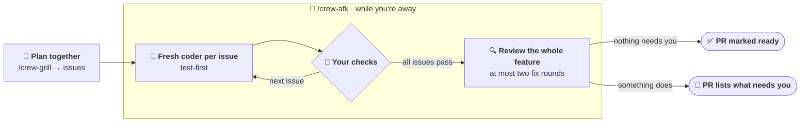

<div align="center">

# Coding Crew

### Describe a feature. Go to lunch. Come back to a reviewed PR.

**Turn the AI coding tool you already use into a whole dev team: a planner, a coder per issue, and a reviewer.**

[](LICENSE)


</div>

---

A coding agent pairs with you one prompt at a time. Coding Crew works more like a team: you agree the
plan together, then it builds the feature **test-first, one issue at a time, each by a fresh coder**.
It lands only what passes your checks, reviews the whole feature, fixes what the review found, and you
get one PR at the end.

## Get going

From inside your repo:

```bash
npx skills add ypxing/coding-crew --all      # this project (commit skills-lock.json); add -g for every repo
```

Needs git, jq and Node; `gh` too for GitHub Issues or Actions.

Installing only some skills (`-s <name>`)? Add `-s coding-crew-lib` too: every skill runs its scripts from it.
To update, re-run the same command. The [install guide](docs/guide.md#install) covers `bootstrap.sh`, a pinned
install from a clone, and what lands where.

Then, inside your coding agent:

```bash
/setup-coding-crew                                # once per repo: tracker + your dev commands
/crew-grill add rate limiting to the public API   # 👤 plan it together → issues
/crew-afk rate-limit                              # 🤖 the crew builds it in its own worktree while you're away
/crew-afk status                                  # which PRs are ready for you
```

That's the whole workflow. On Codex the form is `$crew-grill`, on pi `/skill:crew-grill`.
[Which agents run the skills](docs/guide.md#which-agents).

## How it works



1. **Plan.** `/crew-grill` (or `/crew-brainstorm` for a fuzzy idea) settles the edge cases and splits the work
   into small issues with testable acceptance criteria.
2. **Build.** `/crew-afk` hands each issue to a fresh coder in the feature's own worktree; an issue lands only
   when it passes your checks.
3. **Review.** A reviewer reads the whole feature against the plan; the crew fixes what it found, then stops.
4. **Ship.** You get one PR: marked ready, or listing what needs you.

## What people use it for

| You want to…                               | Run                                                                                                                                      |
| ------------------------------------------ | ---------------------------------------------------------------------------------------------------------------------------------------- |
| 🚀 **Ship a feature while you're away**     | `/crew-grill <idea>` → `/crew-afk <slug>`                                                                                                |
| 🌫️ **Start from a fuzzy idea**              | `/crew-brainstorm <idea>` → `/crew-afk <slug>`                                                                                           |
| 🐛 **Burn down a bug backlog**              | `/to-issues <the bugs>` → `/crew-afk <slug>`                                                                                             |
| 🔀 **Build several features in parallel**   | one `/crew-afk <slug>` per feature, then `/crew-afk status`                                                                              |
| ☁️ **Let the crew build on GitHub Actions** | `/setup-coding-crew` (yes to Actions), then label an issue `run-agent` ([setup](docs/guide.md#solve-feature-on-github-actions-optional)) |
| 💬 **Clear a PR's review comments**         | `/address-pr-comments`                                                                                                                   |
| 🎯 **Pair on a single issue yourself**      | `/solve-issue <issue>`                                                                                                                   |
| ✏️ **Make one small change**                | ask your agent directly; for a crew-built, reviewed PR: `/to-issues <change>` → `/crew-afk <slug>`                                       |

When a plan is already one complete, testable change, `/crew-grill` skips its questions and writes the issue.

## Why teams use it

- ✅ **Test-first.** Every coder works red, green, refactor.
- 🚦 **Nothing red lands.** Your own checks are the gate, not the model's opinion of its own work.
- 🔍 **A reviewer that sees the whole feature.** It reviews against the plan, not one diff at a time.
- 🔁 **Fixes itself, within bounds.** It fixes what the review found, each fix gated by your checks, then stops.
- 🙋 **Only what needs you.** A PR it could not finish lists what needs a person; one it could is marked ready.
- ☁️ **Runs where you want.** In its own worktree on your machine, or on GitHub Actions from an issue label.
- 🧩 **Agent-agnostic.** Plain [Agent Skills](https://agentskills.io) that any agent loading `SKILL.md` can run. Issues stay as local markdown or in GitHub Issues.

## The toolkit

<details>
<summary>All commands</summary>

| Command                  | What it does                                               |
| ------------------------ | ---------------------------------------------------------- |
| `/crew-grill`            | Stress-test a plan and turn it into issues                 |
| `/crew-brainstorm`       | Shape a fuzzy idea into a design, then issues              |
| `/to-issues`             | Split a plan into issues, or sharpen an existing one       |
| `/crew-triage`           | Triage an issue unattended: build it, or ask its questions |
| `/crew-afk`              | Run a feature in its own worktree; see how it ended        |
| `/solve-feature`         | Run one feature's issues on one branch, each one verified  |
| `/crew-review`           | Review a branch or PR against its spec; report only        |
| `/address-pr-comments`   | Fix PR review comments                                     |
| `/solve-issue`           | Build one issue end to end, yourself                       |
| `/write-pr`              | Write a PR description a reviewer can act on               |
| `/setup-coding-crew`     | Set up tracker, checks and the optional Actions workflow   |
| `/configure-tracker`     | Choose local markdown or GitHub Issues                     |

</details>

## Learn more

- [User guide](docs/guide.md#part-2-using-this-repo-in-your-project): install options, configuration, the full pipeline, troubleshooting
- [Contributor guide](docs/guide.md#part-1-contributing-to-this-repo): adding skills and evolving the crew

## Acknowledgements

Several skills are borrowed from [Matt Pocock's skills collection](https://github.com/mattpocock/skills)
(MIT License, Copyright © 2026 Matt Pocock). See [LICENSE](LICENSE) for the full notice. Thanks Matt.

The `/crew-grill` design pipeline incorporates ideas from
[obra/superpowers](https://github.com/obra/superpowers). Thanks Jesse.
