<div align="center">

# Coding Crew

### Describe a feature. Go to lunch. Come back to a reviewed PR.

**Turn the AI coding tool you already use into a whole dev team: a planner, a coder per issue, and a reviewer.**

[](LICENSE)


</div>

---

A coding agent pairs with you one prompt at a time. Coding Crew works more like a team: you agree the
plan together, then it builds the feature **test-first, one issue at a time, each by a fresh coder**.
It lands only what passes your checks, reviews the whole feature, fixes what the review found, and you
get one PR at the end.

## Get going in two commands

```bash
curl -fsSL https://raw.githubusercontent.com/ypxing/coding-crew/main/bootstrap.sh | bash
```

That installs every skill at user level (under `~`). To install into one repo instead, run it from
inside the repo with `| bash -s -- --project` (or `./install.sh <platform> --project` from a clone).

Then, inside Claude Code, Copilot CLI, Codex CLI or [pi](https://github.com/badlogic/pi-mono):

```bash
/crew-grill add rate limiting to the public API   # 👤 plan it together → PRD + issues
/crew-afk rate-limit                              # 🤖 the crew builds it in its own worktree while you're away
/crew-afk status                                  # how each run ended: ready pr=<n>, needs-attention, …
```

That's the whole workflow.

## How it works

```mermaid
flowchart LR
    idea(["💡 <b>Your idea</b>"]) --> plan

    subgraph you1 ["👤 You"]
        plan["🧭 <b>Plan together</b><br/><code>/crew-grill</code>"]
    end

    plan --> issues

    subgraph crew ["🤖 The crew · /crew-afk → /solve-feature · while you're away"]
        direction LR
        issues["📋 <b>PRD + issues</b><br/>testable criteria"]
        issues --> c1["🧪 <b>Coder</b><br/>TDD · one issue"]
        c1 --> gate{{"🚦 <b>Gate</b><br/>your checks + criteria"}}
        gate -- "next issue" --> c1
        gate -- "all landed" --> review["🔍 <b>Feature review</b><br/>against the PRD"]
        review -. "fix findings once" .-> gate
    end

    review --> pr

    subgraph you2 ["👤 You"]
        pr(["✅ <b>One reviewed PR</b>"])
    end

    classDef human fill:#dbeafe,stroke:#2563eb,stroke-width:2px,color:#1e3a8a
    classDef bot fill:#ffffff,stroke:#64748b,stroke-width:1.5px,color:#0f172a
    classDef code fill:#ecfdf5,stroke:#059669,stroke-width:1.5px,color:#064e3b
    classDef gate fill:#fef3c7,stroke:#d97706,stroke-width:2px,color:#78350f
    classDef done fill:#dcfce7,stroke:#16a34a,stroke-width:2.5px,color:#14532d
    class idea,plan human
    class issues,review bot
    class c1 code
    class gate gate
    class pr done
    style you1 fill:#eff6ff,stroke:#93c5fd,color:#1e3a8a
    style you2 fill:#eff6ff,stroke:#93c5fd,color:#1e3a8a
    style crew fill:#f8fafc,stroke:#cbd5e1,color:#334155
```



1. **Plan.** `/crew-grill` questions your idea until the edge cases are decided, then splits the work
   into small issues with testable acceptance criteria. If you're starting from a fuzzy idea,
   `/crew-brainstorm` shapes it first.
2. **Build.** `/crew-afk` starts `/solve-feature` unattended in the feature's own worktree — locally
   (capped at $10 and an hour), or in an orca or herdr terminal with `--to` — and returns at once.
   `/solve-feature` hands each issue, in order, to a fresh coder on one branch. Each one has to pass
   your own checks and meet its acceptance criteria before it lands in the feature's draft PR.
3. **Review.** A reviewer reads the whole feature against the plan and catches what no single issue
   shows. The crew fixes the findings once, gated by your checks, and the run stops.
4. **Ship.** The PR is marked ready when nothing needs a person; otherwise it lists what does. You
   review one PR.

## What people use it for

| You want to…                              | Run                                                         |
| ----------------------------------------- | ----------------------------------------------------------- |
| 🚀 **Ship a feature overnight**           | `/crew-grill <idea>` → `/crew-afk <slug>`                   |
| 🐛 **Burn down a bug backlog**            | `/to-issues <ref>` for each bug, then `/solve-feature`      |
| 🧪 **Cover risky untested code**          | `/add-tests` → `/solve-feature`                             |
| 📦 **Upgrade dependencies safely**        | `/upgrade-deps` → `/solve-feature`                          |
| 🔀 **Build several features in parallel** | one `/crew-afk <slug>` per feature, each in its own worktree |
| 💬 **Clear a PR's review comments**       | `/address-pr-comments`                                      |
| 🎯 **Pair on a single issue yourself**    | `/solve-issue <issue>`                                      |

Small, well-defined changes skip the Q&A. `/crew-grill` hands them straight to the issue writer.

## Why teams use it

- ✅ **Test-first, always.** Every coder works red, green, refactor.
- 🚦 **Nothing red merges.** Your own checks are the gate, not the model's opinion of its own work.
- 🔍 **A reviewer that sees the whole feature.** It reviews against the plan, not one diff at a time.
- 🔁 **Fixes itself without looping.** One fix round, gated by your checks, then it stops.
- 🙋 **Only what needs you.** A PR it could not finish lists what needs a person; one it could is marked ready.
- 🧩 **Fits what you already use.** It works with four coding CLIs, and keeps issues as local markdown or in GitHub Issues.

## The toolkit

| Command                  | What it does                                               |
| ------------------------ | ---------------------------------------------------------- |
| `/crew-grill`            | Stress-test a plan and turn it into issues                 |
| `/crew-brainstorm`       | Shape a fuzzy idea into a design, then issues              |
| `/to-issues`             | Split a plan into issues, or sharpen an existing one       |
| `/crew-afk`              | Start a feature's run in its own worktree; see how it ended |
| `/solve-feature`         | Run one feature's issues on one branch, each one verified  |
| `/address-pr-comments`   | Fix PR review comments, push once your checks pass         |
| `/solve-issue`           | Build one issue end to end, yourself                       |
| `/add-tests`             | Find risky untested code and plan tests for it             |
| `/upgrade-deps`          | Audit outdated packages and plan safe upgrades             |
| `/write-pr`              | Write a PR description a reviewer can act on               |
| `/configure-tracker`     | Choose local markdown or GitHub Issues                     |

## Learn more

- [User guide](docs/guide.md#part-2-using-this-repo-in-your-project): install options, configuration, the full pipeline, troubleshooting
- [Contributor guide](docs/guide.md#part-1-contributing-to-this-repo): adding skills and evolving the crew

## Acknowledgements

Several skills are borrowed from [Matt Pocock's skills collection](https://github.com/mattpocock/skills)
(MIT License, Copyright © 2026 Matt Pocock). See [LICENSE](LICENSE) for the full notice. Thanks Matt.

The `/crew-grill` design pipeline incorporates ideas from
[obra/superpowers](https://github.com/obra/superpowers). Thanks Jesse.
